<div align="center">

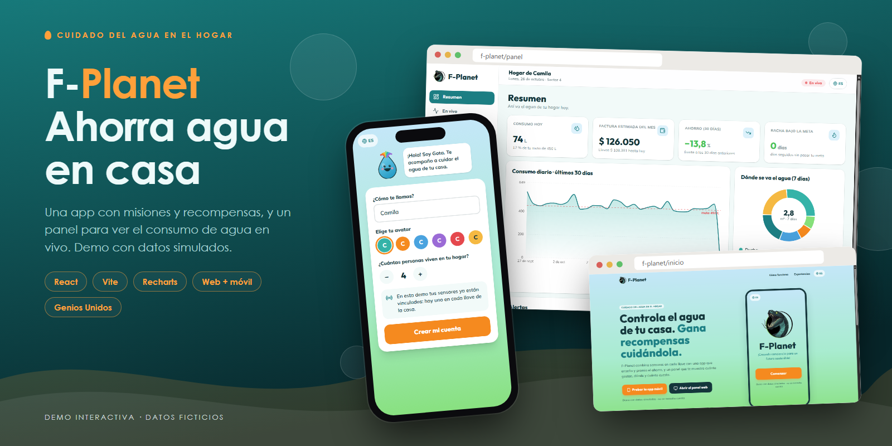


# F-Planet

**Controla el agua de tu hogar y gana recompensas cuidándola**

Sensores en cada llave + una app móvil que enseña y premia el ahorro + un panel web que muestra cuánto gastas, dónde y cuánto cuesta.

[](https://cabrales16.github.io/F-Planet/)


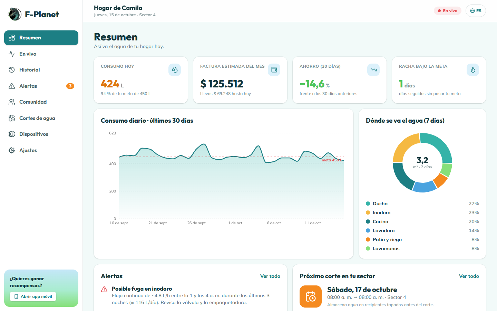

</div>

---

## 📑 Contenido

- [Descripción general](#-descripción-general)
- [Demo en vivo](#-demo-en-vivo)
- [Galería](#-galería)
- [Cómo funciona](#-cómo-funciona)
- [Datos simulados](#-datos-simulados)
- [Accesibilidad](#-accesibilidad)
- [Estructura del proyecto](#-estructura-del-proyecto)
- [Instalación y ejecución local](#-instalación-y-ejecución-local)
- [Despliegue](#-despliegue)
- [Del mockup a la demo](#-del-mockup-a-la-demo)
- [Futuras mejoras](#-futuras-mejoras)
- [Equipo](#-equipo)

## 📌 Descripción general

Cuando el agua se raciona por sectores, como ocurre en Bogotá, cada litro cuenta. **F-Planet** ayuda a los hogares a medir su consumo, detectar fugas a tiempo y convertir el ahorro en un hábito compartido por toda la cuadra.

El proyecto tiene dos experiencias que comparten el mismo hogar y los mismos datos:

| | 📱 App móvil | 🖥️ Panel web (PC / tablet) |
|---|---|---|
| **Enfoque** | Aprender y ganar, como un juego | Ver y entender el consumo |
| **Qué ofrece** | Camino de misiones con tips y preguntas, racha diaria, gotas, cupones, ranking de cuadras y premiación | Caudal de cada llave en vivo, historial por día/hora/llave, alertas de fuga y exceso, factura estimada, cortes programados |
| **Cuándo se usa** | A diario, en pocos minutos | Para revisar, comparar y ajustar metas |

## 🎮 Demo en vivo

👉 **https://cabrales16.github.io/F-Planet/**

La demo es **100 % funcional y no necesita backend ni cuenta**. Todo se ejecuta en el navegador: un simulador de sensores genera el consumo del hogar y el progreso se guarda en `localStorage`. Lo que haces en la app móvil se refleja en el panel (comparten origen), y puedes volver al estado inicial en cualquier momento con **«Restaurar datos de la demo»**.

| Ruta | Qué es |
|---|---|
| [`/#/`](https://cabrales16.github.io/F-Planet/#/) | Página de presentación |
| [`/#/app`](https://cabrales16.github.io/F-Planet/#/app) | App móvil (en pantallas grandes se muestra dentro de un marco de teléfono) |
| [`/#/panel`](https://cabrales16.github.io/F-Planet/#/panel) | Panel web |

**Qué probar**

| En la app móvil | En el panel web |
|---|---|
| Registrarte (nombre, avatar, personas del hogar) | Ver el caudal de cada llave **actualizándose en vivo** |
| Completar la misión «Platos sin chorro continuo»: tip → pregunta → reto → recompensa | Revisar la **alerta de fuga** en el inodoro y marcarla como vista |
| Canjear un cupón en la tienda con las gotas ganadas | Cambiar la meta diaria y la tarifa en **Ajustes** y ver cómo cambia la factura estimada |
| Subir en el ranking de tu cuadra | Exportar el historial a **CSV** |
| Activar idioma EN, letra para dislexia, texto grande o video de señas | Consultar el calendario de cortes y la lista para prepararte |

## 🖼️ Galería

### App móvil

| Camino de misiones | Misión | Recompensa | Tienda |
|:---:|:---:|:---:|:---:|
| 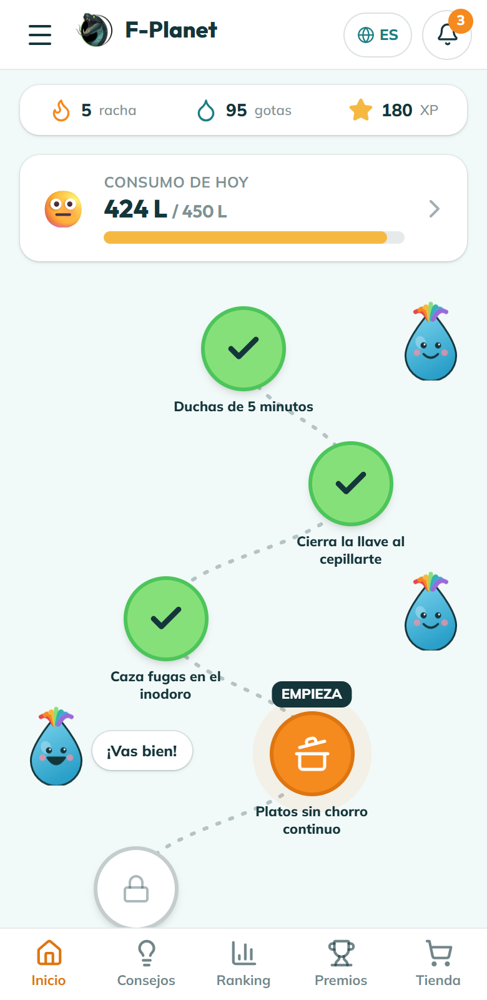 | 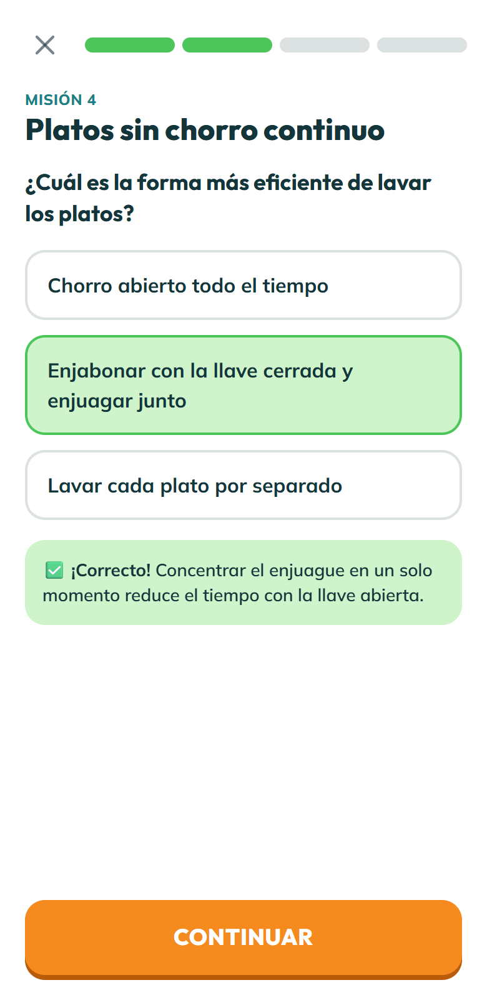 | 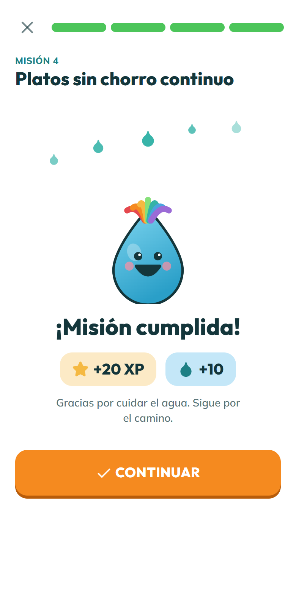 | 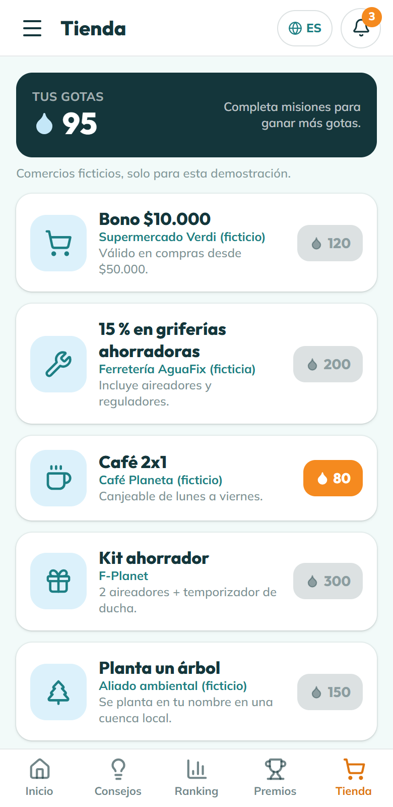 |

| Consumo | Clasificación | Premiación | Novedades |
|:---:|:---:|:---:|:---:|
| 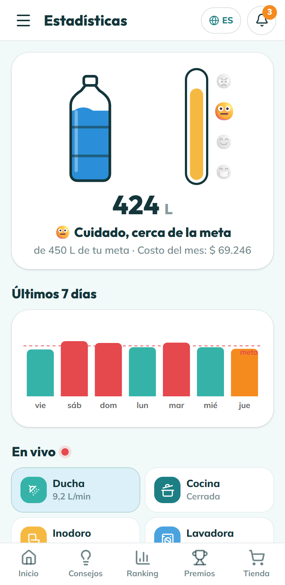 | 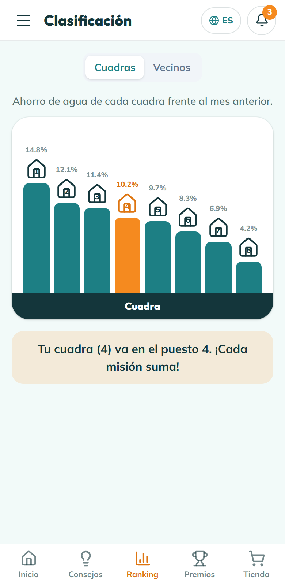 | 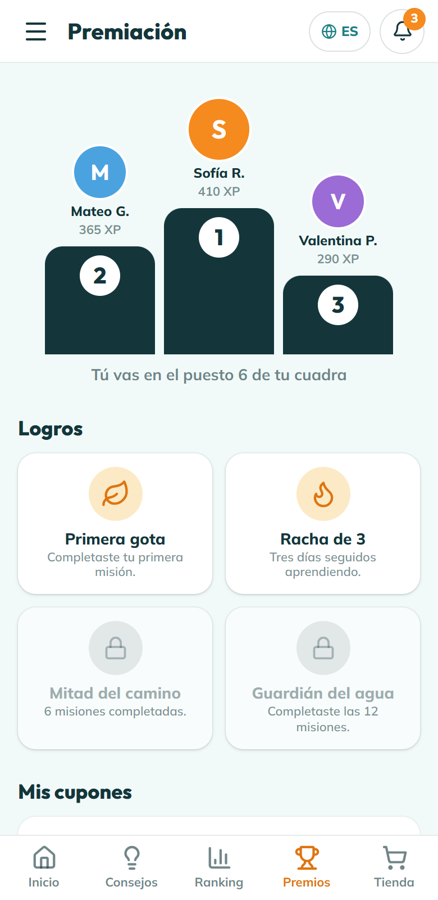 | 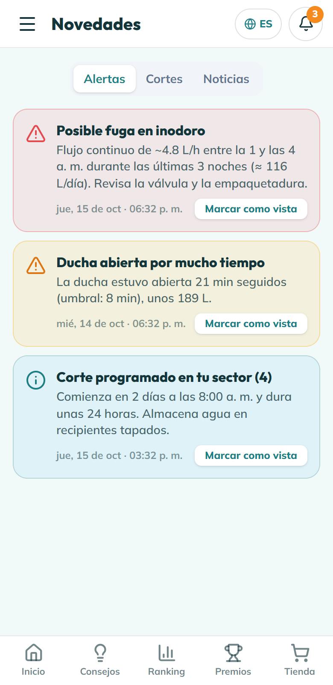 |

### Panel web

| En vivo | Historial |
|:---:|:---:|
| 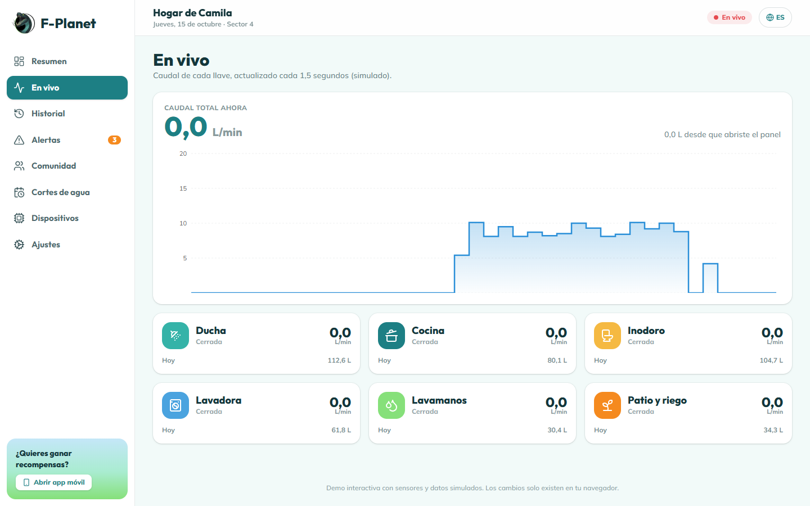 | 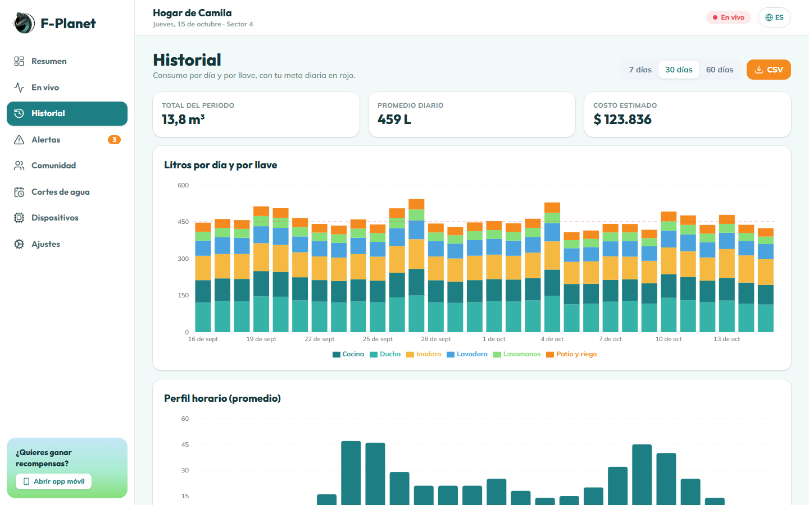 |
| **Alertas** | **Comunidad** |
| 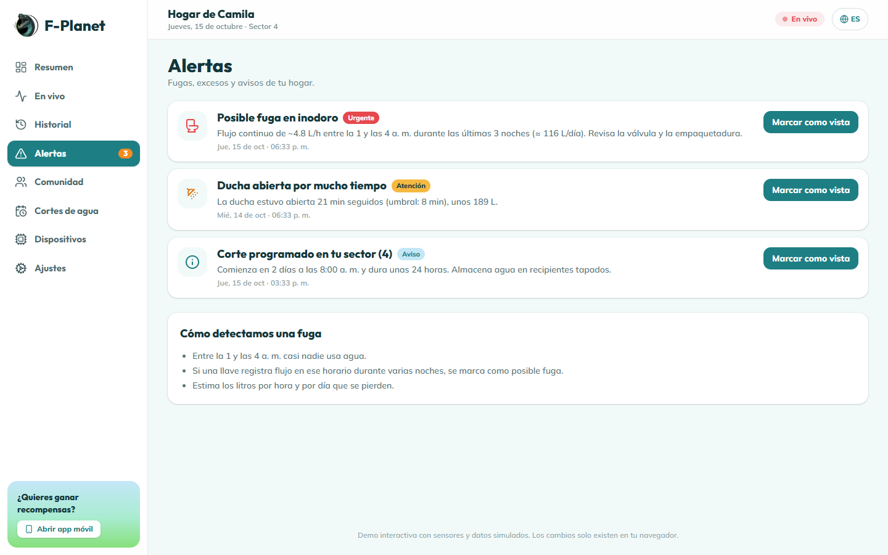 | 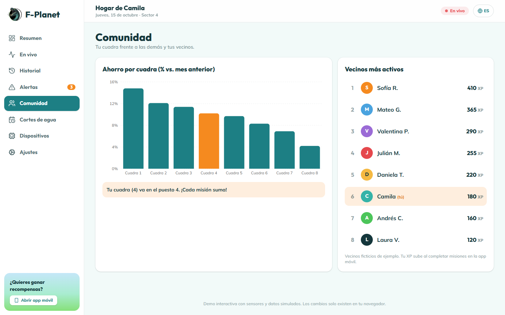 |
| **Cortes de agua** | **Dispositivos** |
| 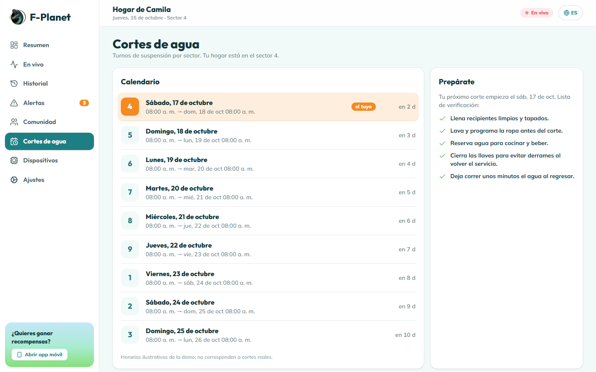 | 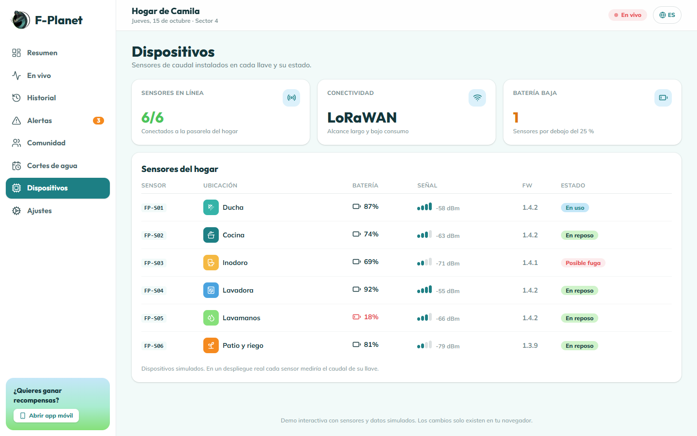 |

El panel es responsivo: en tablet el menú lateral se mantiene y en pantallas pequeñas pasa a una barra superior.

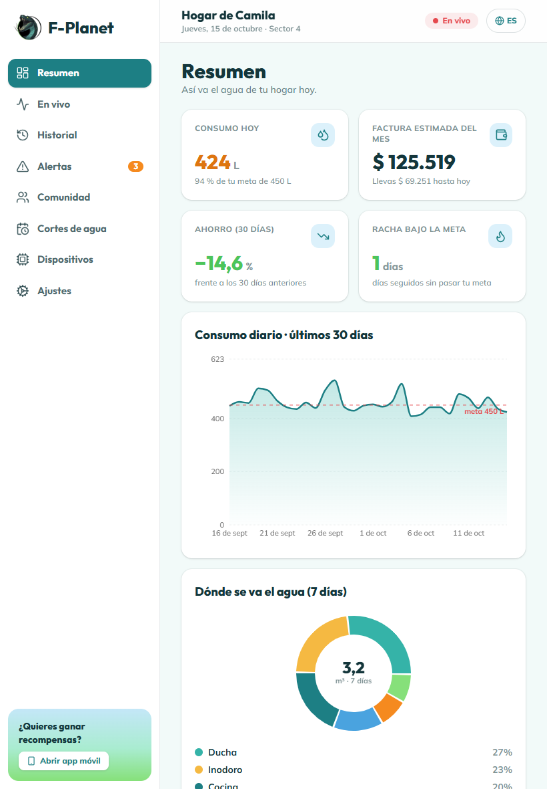

## ⚙️ Cómo funciona

```
   Sensores por llave            App móvil                 Panel web
 ┌──────────────────┐      ┌────────────────┐      ┌──────────────────────┐
 │ ducha · cocina   │      │ misiones + XP  │      │ caudal en vivo       │
 │ inodoro · lavad. │ ───► │ gotas, cupones │ ◄──► │ historial y costos   │
 │ lavamanos · patio│      │ ranking cuadra │      │ alertas y cortes     │
 └──────────────────┘      └────────────────┘      └──────────────────────┘
          │                         │                          │
          └────────── hogar compartido (consumo + progreso) ───┘
```

- **Sensores por llave:** miden el caudal de seis puntos del hogar (ducha, cocina, inodoro, lavadora, lavamanos y patio/riego). Así se sabe *dónde* se va el agua, no solo cuánta.
- **Detección de fugas:** entre la 1 y las 4 a. m. casi nadie usa agua. Si una llave registra flujo en esa franja durante varias noches seguidas, se marca como posible fuga y se estima cuántos litros por hora y por día se pierden.
- **Meta y costo:** la meta diaria sale de las personas del hogar y se compara con el consumo en tiempo real. La factura estimada combina el cargo fijo y la tarifa por m³ (ambos configurables).
- **Misiones:** doce misiones cortas (ducha, cepillado, fugas, lavadora, riego, contador, cortes…). Cada una enseña un tip, plantea una pregunta, propone un reto para hoy y entrega XP y gotas.
- **Comunidad:** las cuadras compiten por el mayor ahorro frente al mes anterior y los vecinos suman XP. Las gotas se canjean por cupones en comercios aliados.
- **Cortes de agua:** calendario por sector con una lista de verificación para prepararse.

## 🧪 Datos simulados

No hay hardware ni servidor. Para que la demo se sienta real:

- `src/lib/sim.js` genera de forma **determinista** 60 días de consumo por hora y por llave (picos de mañana y noche, más consumo en fines de semana, tendencia de ahorro y una fuga silenciosa en el inodoro durante las últimas 3 noches).
- El **flujo en vivo** se actualiza cada 1,5 s con un modelo simple de «llave abierta/cerrada» según la hora del día.
- `src/lib/store.js` guarda usuario, progreso, cupones, alertas vistas y ajustes en `localStorage` (clave `fplanet-demo-v1`).
- Comercios aliados, vecinos, cuadras y turnos de corte son **ficticios**; las tarifas son valores de ejemplo editables.

## ♿ Accesibilidad

El mockup original ya contemplaba estas opciones y la demo las implementa:

| Opción | Qué hace |
|---|---|
| **Idioma** | Español / English en toda la interfaz y en el contenido educativo |
| **Tipo de letra** | Fuente estándar o *OpenDyslexic* (pensada para dislexia) |
| **Tamaño de letra** | Cuatro niveles (A-, A, A+, A++) |
| **Video de señas** | Panel de intérprete de Lengua de Señas Colombiana en las misiones (espacio reservado de demostración) |
| **Sonido** | Efectos opcionales al responder y completar misiones |

Además: navegación por teclado con foco visible, roles ARIA en controles personalizados y respeto a `prefers-reduced-motion`.

## 🗂️ Estructura del proyecto

```
F-Planet/
├── src/
│   ├── lib/
│   │   ├── sim.js          # simulador de sensores, historial y flujo en vivo
│   │   ├── store.js        # estado persistido en localStorage
│   │   ├── content.js      # misiones, consejos, tienda, cuadras, cortes, noticias
│   │   ├── alerts.js       # reglas de alertas (fuga, exceso, cortes, logros)
│   │   ├── community.js    # clasificación de vecinos y cuadras
│   │   ├── i18n.js         # textos ES / EN
│   │   └── hooks.js        # useT, useStats, useLive…
│   ├── components/         # Logo, mascota «Gota», botellón, controles de accesibilidad
│   ├── mobile/             # app móvil (camino, misión, tips, ranking, tienda…)
│   ├── panel/              # panel web (resumen, en vivo, historial, alertas…)
│   ├── Landing.jsx         # página de presentación
│   └── App.jsx             # rutas (HashRouter)
├── public/                 # logo y favicon
├── docs/
│   ├── screenshots/        # capturas de la demo
│   └── F - Planet.pdf      # presentación original del proyecto
├── mockups-mobile/         # mockups originales de la app móvil
├── mockups-webapp/         # mockups originales de la versión web
└── .github/workflows/deploy-demo.yml
```

## 🚀 Instalación y ejecución local

Requisitos: **Node.js 20+**.

```bash
git clone https://github.com/Cabrales16/F-Planet.git
cd F-Planet
npm install
npm run dev:demo      # abre http://localhost:5173/F-Planet/
```

| Script | Descripción |
|---|---|
| `npm run dev` / `dev:demo` | Servidor de desarrollo (la demo usa la base `/F-Planet/`) |
| `npm run build` / `build:demo` | Compila para producción |
| `npm run preview:demo` | Sirve la compilación de la demo |
| `npm run lint` | ESLint |

## 🌐 Despliegue

La demo se publica en **GitHub Pages** con el pipeline de **Jekyll** (`actions/jekyll-build-pages`):

1. Cada push a `main` ejecuta [`deploy-demo.yml`](.github/workflows/deploy-demo.yml): `npm ci` → `lint` → `build:demo` → Jekyll entrega `dist/` → `deploy-pages`.
2. En **Settings → Pages**, elige **Source: GitHub Actions**.
3. Se usa `HashRouter`, por lo que no hacen falta redirecciones.

> Si renombras el repositorio, actualiza `base` en [`vite.config.js`](vite.config.js).

## 🎨 Del mockup a la demo

El punto de partida fueron los mockups de [`mockups-mobile`](mockups-mobile) y [`mockups-webapp`](mockups-webapp) y la [presentación](docs/F%20-%20Planet.pdf). La demo conserva su espíritu y lo lleva más lejos:

| En el mockup | En la demo |
|---|---|
| Camino de hojas con mascota al estilo Duolingo | Camino de 12 misiones con estados (completada, actual, bloqueada), racha, XP y mascota «Gota» |
| Pantalla «Consumo» con botellón y termómetro de emojis | Botellón que se llena según tu meta, termómetro de ánimo, gráfica de 7 días y caudal por llave en vivo |
| «Clasificación» por cuadra y «Premiación» con podio | Ranking de cuadras y vecinos que reacciona a tu progreso, podio y logros |
| «Consejos» con globos de texto | Consejos paginados con la mascota |
| «Configuración» con cuatro casillas | Sonido, tipo y tamaño de letra, video de señas e idioma, con efecto real |
| Cupones en tiendas | Tienda con canje de cupones y código |
| Versión PC para ver gastos | Panel con resumen, tiempo real, historial, alertas, comunidad, cortes y dispositivos |

La paleta sale del logo: verde azulado profundo, degradado cielo → verde hoja y naranja para las acciones principales.

## 🔮 Futuras mejoras

Ideas para pasar de demo a producto (no están implementadas):

- Conexión con sensores de caudal reales y una pasarela por hogar.
- Backend con autenticación, historial persistente y notificaciones push.
- Datos reales de cortes y sectores desde la fuente oficial del acueducto.
- Convenios reales con comercios para los cupones.
- Video real de interpretación en Lengua de Señas Colombiana.
- Modo comunitario: retos entre cuadras con metas semanales.

## 👥 Equipo

Proyecto del equipo **Genios Unidos**, renovado como demo interactiva.

- Repositorio: [Cabrales16/F-Planet](https://github.com/Cabrales16/F-Planet)
